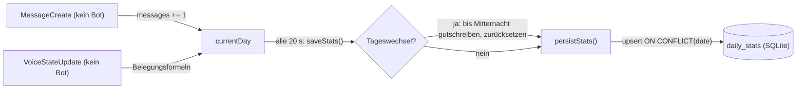
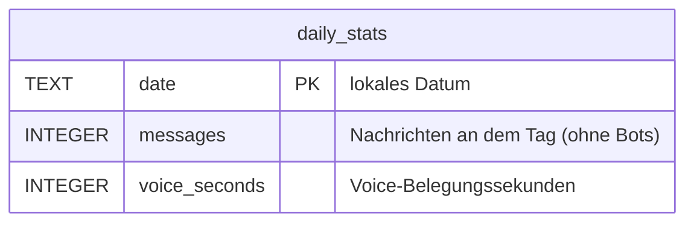

<p align="center">
  
</p>

<h1 align="center">Giraffe</h1>

<p align="center">
  <b>Ein Discord-Bot mit Mistral-AI-Commands und Web-Dashboard.</b><br>
  KI · Websuche · Bilder · Umfragen · Geburtstage · Aktivitätsstatistik
</p>

<p align="center">
  
  
  
  <a href="LICENSE"></a>
</p>

<p align="center"><a href="README.md">English</a> · <b>Deutsch</b></p>

> **Beta:** läuft im Alltag auf unserem Server; Details können sich noch ändern.

## Funktionen

- `/ai <prompt>` – Mistral Large 4 fragen, Kosten pro Anfrage im Footer
- `/websearch <frage>` – Antwort mit Live-Websuche, inklusive Quellen
- `/image <prompt>` – Bild über einen Mistral-Bild-Agenten erzeugen
- `/poll <frage> <optionen>` – native Discord-Umfrage (2–10 kommagetrennte Optionen, optional Mehrfachauswahl, läuft 24 h)
- `/birthday` – eigenen Geburtstag setzen, anzeigen oder löschen
- `/ping` – Latenz prüfen
- Tägliches Nachrichten- und Voice-Tracking in SQLite (anonymisiert: keine User-IDs, nur Personenzahl pro Channel)
- Geburtstags-Scheduler: prüft täglich um 12:00 (holt nach, wenn der Bot offline war), Rolle aus `BIRTHDAY_ROLE_ID`
- Auto-Rolle für neue Mitglieder über `AUTO_ROLE_ID`
- Web-Dashboard: Bot-Status, Statistiken, Geburtstage, Nachrichten als Bot senden

## Einrichtung

```bash
npm install
cp .env.example .env   # Werte eintragen
npm run deploy         # Slash-Commands registrieren (einmalig und nach Command-Änderungen)
npm start
```

Docker: `docker compose up -d` (liest `.env` per `env_file`, Dashboard auf Host-Port `8081`).

## Konfiguration (`.env`)

| Variable | Beschreibung | Beispiel / Standard |
|---|---|---|
| `TOKEN` | Discord-Bot-Token | … |
| `MISTRAL_API_KEY` | API-Key von [console.mistral.ai](https://console.mistral.ai) | … |
| `BASE_URL` | API-Basis-URL | `https://api.mistral.ai/v1` |
| `AI_MODEL` | Modell-ID | `mistral-large-4-0` |
| `AI_REASONING_EFFORT` | `none` (schnell) oder `high` (Thinking-Chunks, mehr Tokens) | `none` |
| `IMAGE_MODEL` | Modell des Bild-Agenten für `/image` | `mistral-medium-3-5` |
| `WEBSEARCH_MODEL` | Modell des Websearch-Agenten für `/websearch` | `mistral-medium-3-5` |
| `AI_SYSTEM_PROMPT` | System-Prompt für die KI | … |
| `PRICE_PER_MIO_INPUT_TOKENS` | USD pro 1 Mio. Input-Tokens | `0.68` |
| `PRICE_PER_MIO_OUTPUT_TOKENS` | USD pro 1 Mio. Output-Tokens | `2.09` |
| `PROVIDER` | Provider-Name für den Footer | `Mistral AI` |
| `PROVIDER_PRIVACY` | Link zur Datenschutzrichtlinie | `https://mistral.ai/privacy-policy` |
| `DASHBOARD_PORT` | Port des Dashboards | `8080` |
| `DASHBOARD_HOST` | Bindung (`127.0.0.1` = nur lokal; `0.0.0.0` im Docker-Container) | `127.0.0.1` |
| `DASHBOARD_TOKEN` | Wenn gesetzt, brauchen alle API-Requests `Authorization: Bearer <Token>` | (leer = kein Schutz) |
| `BIRTHDAY_ROLE_ID` | Rolle, die der Bot am Geburtstag vergibt | (leer = keine Rolle) |
| `AUTO_ROLE_ID` | Rolle, die jedes neu beigetretene Mitglied bekommt | (leer = keine Rolle) |
| `DB_PATH` | SQLite-Datei | `database.db` im Projektordner |

## Web-Dashboard

Der Bot startet automatisch ein Web-Dashboard unter `http://127.0.0.1:8080` (konfigurierbar). Es zeigt:

- **Status:** Bot-Tag, Avatar, WS-Ping, Presence, Uptime (Prozess/Bot), Speicher, Node-Version, Server/Mitglieder/Channel-Zahlen
- **Statistiken:** tägliche Nachrichten- und Voice-Zeitreihen aus der SQLite-DB (`daily_stats`, letzte 60 Tage)
- **Geburtstage:** alle Einträge aus der `birthdays`-Tabelle
- **Nachricht senden:** als Bot in jeden Textkanal senden – Channel-ID und Text angeben (optional `@everyone`/Rollen-Pings erlauben)

Für den Zugriff von außerhalb einen Reverse-Proxy (z. B. Nginx/Caddy) mit HTTPS vor das
Dashboard schalten und `DASHBOARD_TOKEN` setzen.

## Kostenberechnung

```
kosten = (prompt_tokens / 1.000.000)     * PRICE_PER_MIO_INPUT_TOKENS
       + (completion_tokens / 1.000.000) * PRICE_PER_MIO_OUTPUT_TOKENS
```

Die Token-Zahlen kommen aus dem `usage`-Feld der API-Antwort. Fehlen sie, werden keine Kosten angezeigt.

## Aktivitäts-Tracking

### Laufzeitzustand (im Speicher)

| Variable | Typ | Beschreibung |
|---|---|---|
| `currentDay.date` | `string` | Aktuelles lokales Datum |
| `currentDay.messages` | `integer` | Nachrichten heute (ohne Bots) |
| `currentDay.voiceSeconds` | `integer` | Voice-Belegungssekunden heute |
| `channelHumanCount` | `Map<channelId, int>` | Menschen pro Voice-Channel |
| `channelOccupiedSince` | `Map<channelId, timestamp>` | Belegt seit (vom ersten Menschen gesetzt, nur zur Laufzeit) |

### Formeln

```
erster Mensch kommt:         occupied_since = jetzt
letzter Mensch geht:         voice_seconds += floor((jetzt - occupied_since) / 1000)
Tageswechsel bei Belegung:   voice_seconds += floor((Mitternacht - occupied_since) / 1000)
                             occupied_since = Mitternacht
Channel-Wechsel:             alten Channel verlassen + neuen betreten
```

`occupied_since` existiert nur zur Laufzeit; nach einem Neustart werden belegte Channels ab dem Neustart gezählt (Zeit davor zählt nicht).

### Ablauf von Aktualisierung und Speicherung



## Datenbank (`database.db`, SQLite)



`daily_stats` wird alle 20 Sekunden per Upsert geschrieben. `voice_seconds` misst **Belegungszeit, nicht Personenzeit**: 2 Personen 60 s in einem Channel zählen als 60 s. Die Zähler werden um Mitternacht (lokal) zurückgesetzt; Zeit in noch belegten Channels wird vorher dem alten Tag gutgeschrieben.

## Entwicklung

```bash
npm install
npm test           # Smoke-Test: lädt alle Commands/Events gegen eine In-Memory-DB
npm run check      # alle Prüfungen (derzeit = npm test)
```

```
src/
  index.js            Client, Intents, lädt Commands/Events
  commands/           ein Slash-Command pro Datei (ai, birthday, image, ping, poll, websearch)
  events/             ein Discord-Event pro Datei (guildMemberAdd, interactionCreate, messageCreate, ready, voiceStateUpdate)
  db.js               einziger DB-Handle: run/get/all (node:sqlite, synchron)
  activity.js         Nachrichten-/Voice-Tracking + daily_stats-Persistenz
  birthdays.js        Geburtstags-Verwaltung, Rolle & Wünsche
  ai.js               Mistral-API-Helfer (Agents, Konversationen, Kosten, Embeds)
  dashboard.js        Web-Dashboard-Server (Express: Status/Stats/Senden)
  loaders.js          lädt src/commands und src/events automatisch
public/index.html     Dashboard-Frontend
scripts/
  deploy-commands.js  registriert alle Slash-Commands global
tests/smoke.mjs       Smoke-Test
docs/                 Logo
```

Regeln: neue Commands als Datei in `src/commands/` ablegen (`data` + `execute`), neue Events in
`src/events/` (`name` + `execute`, der Client wird als letzter Parameter übergeben).
Dashboard-Endpoints in `src/dashboard.js` erweitern.

Version: `version` in `package.json` (derzeit `1.3.0-beta`); Änderungen stehen in
[CHANGELOG.md](CHANGELOG.md).

## Lizenz

MIT
