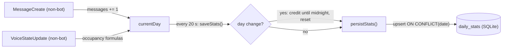
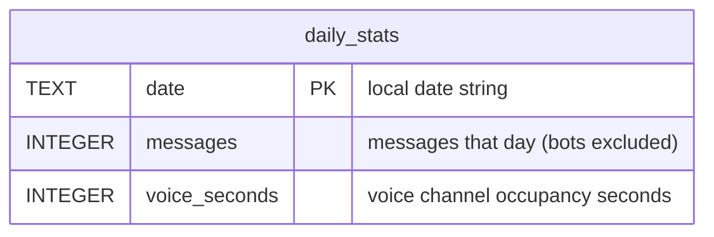

# Giraffe - Discord AI Bot

A Discord bot with a Mistral AI-powered `/ai` command and daily activity tracking, built on **discord.js v14**.

## Features

- `/ai <prompt>` - ask Mistral Large 4, cost per request shown in the footer
- `/websearch <question>` - answer with live web search, sources included
- `/image <prompt>` - generate an image via a Mistral image agent
- `/poll <question> <options>` - create a native Discord poll (2-10 comma-separated options, optional multiselect, runs 24 h)
- `/ping` - latency check
- Daily message and voice activity tracking, stored in SQLite

## Setup

```bash
npm install
cp .env.example .env   # fill in your values
node deploy-commands.js
node index.js
```

Docker: `docker compose up -d` (reads `.env` via `env_file`).

## Configuration (`.env`)

| Variable | Description | Example |
|---|---|---|
| `TOKEN` | Discord bot token | ... |
| `MISTRAL_API_KEY` | API key from [console.mistral.ai](https://console.mistral.ai) | ... |
| `BASE_URL` | API base URL | `https://api.mistral.ai/v1` |
| `AI_MODEL` | Model ID | `mistral-large-4` |
| `AI_REASONING_EFFORT` | `none` (fast) or `high` (thinking chunks, more tokens) | `none` |
| `IMAGE_MODEL` | Model of the image agent for `/image` | `mistral-medium-latest` |
| `WEBSEARCH_MODEL` | Model of the websearch agent for `/websearch` | `mistral-medium-latest` |
| `AI_SYSTEM_PROMPT` | System prompt for the AI | ... |
| `PRICE_PER_MIO_INPUT_TOKENS` | USD per 1M input tokens | `0.68` |
| `PRICE_PER_MIO_OUTPUT_TOKENS` | USD per 1M output tokens | `2.09` |
| `PROVIDER` | Provider name for the footer | `Mistral AI` |
| `PROVIDER_PRIVACY` | Privacy policy link | `https://mistral.ai/privacy-policy` |

## Cost calculation

```
cost = (prompt_tokens / 1,000,000)     * PRICE_PER_MIO_INPUT_TOKENS
     + (completion_tokens / 1,000,000) * PRICE_PER_MIO_OUTPUT_TOKENS
```

Token counts come from the API response's `usage` field. If no usage data is returned, no cost is shown.

## Activity tracking

### Runtime state (in memory)

| Variable | Type | Description |
|---|---|---|
| `currentDay.date` | `string` | Current local date |
| `currentDay.messages` | `integer` | Messages today (bots excluded) |
| `currentDay.voiceSeconds` | `integer` | Voice occupancy seconds today |
| `channelHumanCount` | `Map<channelId, int>` | Humans currently in each voice channel |
| `channelOccupiedSince` | `Map<channelId, timestamp>` | Occupied since (set by first human, runtime-only) |

### Formulas

```
first human joins:         occupied_since = now
last human leaves:         voice_seconds += floor((now - occupied_since) / 1000)
day change while occupied: voice_seconds += floor((midnight - occupied_since) / 1000)
                           occupied_since = midnight
channel move:              leave old channel + join new channel
```

`occupied_since` is runtime-only; after a bot restart, occupied channels are re-seeded at restart time (time before the restart is not counted).

### Update and persistence flow



## Database (`database.db`, SQLite)



Single table, upserted every 20 seconds. `voice_seconds` measures **occupancy time, not person-time**: 2 people in one channel for 60 s count as 60 s. Counters reset at local midnight; time already spent in still-occupied channels is credited to the old day first.

## License

MIT
