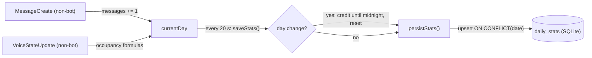
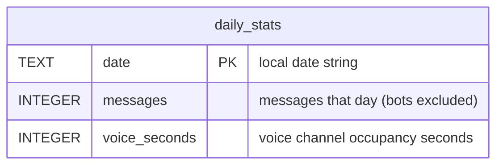

<p align="center">
  
</p>

<h1 align="center">Giraffe</h1>

<p align="center">
  <b>A Discord bot with Mistral AI commands and a web dashboard.</b><br>
  AI · Web search · Images · Polls · Birthdays · Activity stats
</p>

<p align="center">
  
  
  
  <a href="LICENSE"></a>
</p>

<p align="center"><b>English</b> · <a href="README.de.md">Deutsch</a></p>

> **Beta:** runs in daily use on our server; details may still change.

## Features

- `/ai <prompt>` – ask Mistral Large 4, cost per request shown in the footer
- `/websearch <question>` – answer with live web search, sources included
- `/image <prompt>` – generate an image via a Mistral image agent
- `/poll <question> <options>` – create a native Discord poll (2–10 comma-separated options, optional multiselect, runs 24 h)
- `/birthday` – set, show or delete your birthday
- `/ping` – latency check
- Daily message and voice activity tracking, stored in SQLite (anonymized: no user IDs, just per-channel human counts)
- Birthday scheduler: checks once daily at 12:00 (catches up if the bot was offline), role from `BIRTHDAY_ROLE_ID`
- Auto-role for new members via `AUTO_ROLE_ID`
- Web dashboard: bot status, statistics, birthdays, send messages as the bot

## Setup

```bash
npm install
cp .env.example .env   # fill in your values
npm run deploy         # register slash commands (once, and after command changes)
npm start
```

Docker: `docker compose up -d` (reads `.env` via `env_file`, dashboard on host port `8081`).

## Configuration (`.env`)

| Variable | Description | Example / default |
|---|---|---|
| `TOKEN` | Discord bot token | … |
| `MISTRAL_API_KEY` | API key from [console.mistral.ai](https://console.mistral.ai) | … |
| `BASE_URL` | API base URL | `https://api.mistral.ai/v1` |
| `AI_MODEL` | Model ID | `mistral-large-4-0` |
| `AI_REASONING_EFFORT` | `none` (fast) or `high` (thinking chunks, more tokens) | `none` |
| `IMAGE_MODEL` | Model of the image agent for `/image` | `mistral-medium-3-5` |
| `WEBSEARCH_MODEL` | Model of the websearch agent for `/websearch` | `mistral-medium-3-5` |
| `AI_SYSTEM_PROMPT` | System prompt for the AI | … |
| `PRICE_PER_MIO_INPUT_TOKENS` | USD per 1M input tokens | `0.68` |
| `PRICE_PER_MIO_OUTPUT_TOKENS` | USD per 1M output tokens | `2.09` |
| `PROVIDER` | Provider name for the footer | `Mistral AI` |
| `PROVIDER_PRIVACY` | Privacy policy link | `https://mistral.ai/privacy-policy` |
| `DASHBOARD_PORT` | Dashboard port | `8080` |
| `DASHBOARD_HOST` | Bind address (`127.0.0.1` = local only; `0.0.0.0` inside Docker) | `127.0.0.1` |
| `DASHBOARD_TOKEN` | If set, every API request needs `Authorization: Bearer <token>` | (empty = no protection) |
| `BIRTHDAY_ROLE_ID` | Role the bot assigns on a member's birthday | (empty = no role) |
| `AUTO_ROLE_ID` | Role every newly joined member gets | (empty = no role) |
| `DB_PATH` | SQLite file | `database.db` in the project root |

## Web dashboard

The bot starts a web dashboard at `http://127.0.0.1:8080` (configurable). It shows:

- **Status:** bot tag, avatar, WS ping, presence, uptime (process/bot), memory, Node version, server/member/channel counts
- **Statistics:** daily message and voice time series from the SQLite DB (`daily_stats`, last 60 days)
- **Birthdays:** all entries from the `birthdays` table
- **Send message:** send as the bot to any text channel – channel ID and text (optionally allow `@everyone`/role pings)

For access from outside, put a reverse proxy (e.g. Nginx/Caddy) with HTTPS in front of the
dashboard and set `DASHBOARD_TOKEN`.

## Cost calculation

```
cost = (prompt_tokens / 1,000,000)     * PRICE_PER_MIO_INPUT_TOKENS
     + (completion_tokens / 1,000,000) * PRICE_PER_MIO_OUTPUT_TOKENS
```

Token counts come from the API response's `usage` field. If no usage data is returned, no cost is shown.

## Activity tracking

### Runtime state (in memory)

| Variable | Type | Description |
|---|---|---|
| `currentDay.date` | `string` | Current local date |
| `currentDay.messages` | `integer` | Messages today (bots excluded) |
| `currentDay.voiceSeconds` | `integer` | Voice occupancy seconds today |
| `channelHumanCount` | `Map<channelId, int>` | Humans currently in each voice channel |
| `channelOccupiedSince` | `Map<channelId, timestamp>` | Occupied since (set by first human, runtime-only) |

### Formulas

```
first human joins:         occupied_since = now
last human leaves:         voice_seconds += floor((now - occupied_since) / 1000)
day change while occupied: voice_seconds += floor((midnight - occupied_since) / 1000)
                           occupied_since = midnight
channel move:              leave old channel + join new channel
```

`occupied_since` is runtime-only; after a bot restart, occupied channels are re-seeded at restart time (time before the restart is not counted).

### Update and persistence flow



## Database (`database.db`, SQLite)



`daily_stats` is upserted every 20 seconds. `voice_seconds` measures **occupancy time, not person-time**: 2 people in one channel for 60 s count as 60 s. Counters reset at local midnight; time already spent in still-occupied channels is credited to the old day first.

## Development

```bash
npm install
npm test           # smoke test: loads all commands/events against an in-memory DB
npm run check      # all checks (currently = npm test)
```

```
src/
  index.js            client, intents, loads commands/events
  commands/           one slash command per file (ai, birthday, image, ping, poll, websearch)
  events/             one Discord event per file (guildMemberAdd, interactionCreate, messageCreate, ready, voiceStateUpdate)
  db.js               single DB handle: run/get/all (node:sqlite, synchronous)
  activity.js         message/voice tracking + daily_stats persistence
  birthdays.js        birthday management, role & wishes
  ai.js               Mistral API helpers (agents, conversations, cost, embeds)
  dashboard.js        web dashboard server (Express: status/stats/send)
  loaders.js          auto-loads src/commands and src/events
public/index.html     dashboard frontend
scripts/
  deploy-commands.js  registers all slash commands globally
tests/smoke.mjs       smoke test
docs/                 logo
```

Rules: add a command as a file in `src/commands/` (`data` + `execute`), an event in
`src/events/` (`name` + `execute`, the client is passed as the last argument). Extend dashboard
endpoints in `src/dashboard.js`.

Version: `version` in `package.json` (currently `1.3.0-beta`); changes are listed in
[CHANGELOG.md](CHANGELOG.md).

## License

MIT
